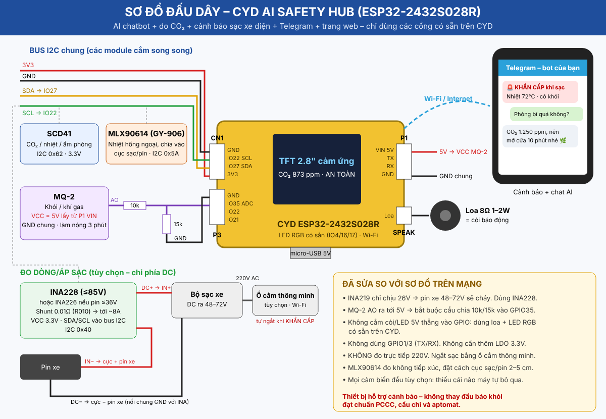

# CYD AI Safety Hub – 5 dự án ESP32 gộp vào 1 board CYD

Firmware Arduino cho board **CYD – ESP32-2432S028R** (màn 2.8" cảm ứng, loại vàng như trong ảnh), gộp 5 dự án:

| # | Dự án | Làm được gì |
|---|-------|-------------|
| 1 | **Trợ lý AI chatbot (Claude)** | Chat qua Telegram hoặc trang web như mọi chatbot: hỏi đáp, dịch, viết, tính toán, tra cứu web (thời tiết, tin tức…). AI biết số liệu cảm biến lúc đó và có thể đổi ngưỡng, tắt còi, ngắt ổ cắm sạc, xem lịch sử khi được nhờ |
| 2 | **Máy đo CO₂ / nhiệt độ / độ ẩm** (SCD41) | Số CO₂ lớn, linh vật đổi nét mặt, biểu đồ 3 giờ, đường 1000 ppm |
| 3 | **Cảnh báo sớm cháy nổ khi sạc xe điện** | Nhiệt cục sạc (MLX90614), tốc độ tăng nhiệt, khói/khí (MQ-2), áp/dòng sạc (INA228/INA226). Có 4 mức: An toàn / Theo dõi / Nguy cơ / KHẨN CẤP, kèm đèn RGB và còi |
| 4 | **Báo về điện thoại** (Telegram) | Cảnh báo theo mức, "sạc xong" (thời gian + Wh), CO₂ cao, tự ngắt ổ cắm thông minh khi khẩn cấp |
| 5 | **Trang web điều khiển** trong mạng nhà | Xem số liệu, chat với AI, cài đặt ngưỡng/khóa API, tắt còi |

> ⚠️ **An toàn:** đây là thiết bị *hỗ trợ cảnh báo*. Nó **không thay thế** đầu báo khói đạt chuẩn PCCC, cầu chì/aptomat hay bộ sạc chính hãng. Không đo trực tiếp điện 220V.

---

## 1. Linh kiện

| Linh kiện | Ghi chú | Bắt buộc? |
|-----------|---------|-----------|
| CYD ESP32-2432S028R | Bản 1 cổng micro-USB (ILI9341). Bản 2 cổng xem mục "Sửa lỗi" | ✅ |
| Loa 8Ω 1–2W (đầu JST 1.25mm 2 chân) | Cắm cổng SPEAK, làm còi báo động | Nên có |
| SCD41 | CO₂ thật (cảm biến NDIR), 3.3V, I2C | Cho dự án 2 |
| MLX90614 (GY-906) | Nhiệt hồng ngoại không tiếp xúc, chĩa vào cục sạc/pin | Cho dự án 3 |
| MQ-2 + điện trở 10k và 15k | Khói/khí gas, cấp 5V | Cho dự án 3 |
| INA228 (≤85V) hoặc INA226 (≤36V) | Đo áp/dòng sạc DC. Thay shunt R100 thành **R010 (0.01Ω)** để đo tới ~8A | Tùy chọn |
| Ổ cắm thông minh chạy Tasmota/Shelly | Ngắt điện sạc từ xa / tự động | Tùy chọn |
| 2 dây JST 1.25mm 4 chân | Cho cổng CN1 và P3 của CYD | ✅ |
| Cục nguồn USB 5V 2A | MQ-2 ăn khoảng 150mA | ✅ |

**Thiếu cảm biến nào thì máy tự bỏ qua cảm biến đó**, nên có thể lắp dần từng phần.

## 2. Đấu dây

| Module | Chân module | Nối vào CYD |
|--------|-------------|-------------|
| SCD41, MLX90614, INA228 (cắm song song) | VCC | CN1 – **3V3** |
| | GND | CN1 – GND |
| | SDA | CN1 – **IO27** |
| | SCL | CN1 – **IO22** |
| MQ-2 | VCC | P1 – **VIN 5V** |
| | GND | GND |
| | AO | Đi qua **R1 10k** tới P3 – **IO35**, rồi từ IO35 qua **R2 15k** xuống GND |
| Loa | 2 dây | Cổng **SPEAK** |
| INA228 | IN+ / IN− | Nối **nối tiếp vào dây DC+** giữa bộ sạc và pin xe (IN+ phía bộ sạc). DC− của bộ sạc nối chung GND với INA |

Những lỗi trong sơ đồ trên mạng đã được sửa ở đây:

- **INA219 chỉ chịu 26V.** Pin xe điện 48–72V sẽ làm cháy nó, nên dùng INA228 (85V).
- MQ-2 xuất tín hiệu tới 5V, còn ADC của ESP32 chỉ đọc được khoảng 3.1V. Vì vậy phải có cầu chia áp 10k/15k (cho ra tối đa 3.0V).
- Không cắm còi 5V thẳng vào GPIO, không dùng GPIO1/3 (TX/RX), không cần thêm LDO. CYD đã có sẵn LED RGB và cổng loa.
- Không gắn cảm biến dòng vào dây 220V. Muốn ngắt sạc thì dùng ổ cắm thông minh.

## 3. Nạp firmware

### Cách A: nạp file .bin bằng trình duyệt (dễ nhất)
1. Tải `cyd_ai_safety_hub_full_0x0.bin` ở trang **Releases → `cyd-ai-hub-latest`** của repo.
2. Mở https://espressif.github.io/esptool-js/ bằng Chrome/Edge, cắm CYD rồi bấm **Connect**.
3. Flash Address để **`0x0`**, chọn file .bin, bấm **Program**.

### Cách B: Arduino IDE
1. Cài **esp32 by Espressif** (bản 3.x) trong Boards Manager.
2. Cài thư viện: **LovyanGFX**, **ArduinoJson** (7.x), **WiFiManager** (của tzapu).
3. Chép cả thư mục `cyd_ai_safety_hub` vào `Documents\Arduino\esp32-projects\` rồi mở file `cyd_ai_safety_hub.ino`.
4. Tools → Board: **ESP32 Dev Module**, Partition Scheme: **Huge APP (3MB No OTA/1MB SPIFFS)**.
5. Bấm Upload.

## 4. Cài đặt lần đầu

1. **Hiệu chỉnh cảm ứng:** lần đầu bật máy, chạm vào đầu mũi tên ở 4 góc màn hình. Muốn làm lại thì chạm giữ màn hình trong lúc cắm điện.
2. **Wi-Fi:** màn hình hiện tên Wi-Fi `CYD-AI-xxxx` kèm mật khẩu. Dùng điện thoại kết nối vào, mở `192.168.4.1`, chọn Wi-Fi nhà, nhập **Anthropic API key** và **Telegram bot token**, rồi bấm Save.
   Sau này muốn đổi Wi-Fi thì **giữ nút BOOT 4 giây**.
3. **Tạo bot Telegram:** nhắn `/newbot` cho **@BotFather**, đặt tên, nhận token dạng `123456:ABC...`.
4. **Ghép đôi:** mở bot vừa tạo, gửi `/pair 123456`, trong đó 123456 là mã PIN hiện ở tab **TRO LY AI** trên màn hình. Ghép được tối đa 4 người.
5. **API key Claude:** tạo ở https://console.anthropic.com. Mặc định máy dùng model `claude-opus-5-5` với mức suy nghĩ `low` (nhanh, tiết kiệm). Có thể đổi model trong tab Cài đặt của trang web. Lưu ý API **tính phí theo lượt dùng**.
6. **Trang web:** vào `http://<IP hiện ở tab AI>` với tài khoản `admin`, mật khẩu là mã PIN.

## 5. Sử dụng

**Màn hình** có 3 tab ở dưới cùng: KHONG KHI, SAC XE, TRO LY AI. Màn hình hiện chữ không dấu vì font chỉ có ASCII. Khi KHẨN CẤP, cả màn hình nháy đỏ; chạm vào để tắt còi 10 phút.

**Telegram:**
- Nhắn bất kỳ câu gì để chat với AI, ví dụ "phòng có bí không?", "dịch giúp câu này", "thời tiết Hải Phòng mai thế nào?", "đặt ngưỡng nhiệt nguy cơ 50 độ", "tắt còi 15 phút".
- `/status` xem số liệu, `/im 10` tắt còi 10 phút, `/batcoi` bật lại còi, `/nguong` xem ngưỡng.
- `/ngatsac` và `/batsac` điều khiển ổ cắm thông minh, `/moi` bắt đầu cuộc trò chuyện mới.

**Ngưỡng mặc định:**

| Tín hiệu | Theo dõi | Nguy cơ | Khẩn cấp |
|----------|----------|---------|----------|
| Nhiệt cục sạc | 45°C | 55°C | 70°C |
| Tốc độ tăng nhiệt | 2°C/phút | 4°C/phút | – |
| Khói/khí (so với nền) | 20% | 40% | – |
| Dòng sạc | 90% của 10A | > 10A | – |
| CO₂ (báo điện thoại) | 1500 ppm | | |

Máy chuyển sang **KHẨN CẤP** khi nhiệt ≥ 70°C, hoặc có ≥ 2 tín hiệu ở mức Nguy cơ cùng lúc, hoặc có khói kèm nhiệt độ cao. Khi đó máy hú còi, nháy đỏ, nhắn Telegram mỗi phút một lần và tự ngắt ổ cắm thông minh nếu đã cài.

## 6. Sửa lỗi thường gặp

| Hiện tượng | Cách xử lý |
|------------|-----------|
| Màn trắng, hình lệch | Board 2 cổng USB dùng ST7789: trong `config.h` đặt `CYD_PANEL_ST7789 1` |
| Màu bị âm bản | `config.h` đặt `CYD_PANEL_INVERT 1` |
| Chạm sai vị trí | Chạm giữ màn hình lúc cắm điện để hiệu chỉnh lại |
| Cảm biến hiện ❌ | Kiểm tra dây SDA (IO27) và SCL (IO22), cấp 3.3V. Máy tự dò lại mỗi 30 giây |
| Khói hiện "lam nong" | MQ-2 cần làm nóng khoảng 3 phút sau khi bật. Lần đầu dùng nên để chạy 24 giờ |
| AI báo lỗi 401 | Sai API key, nhập lại trong trang web |
| Bot không trả lời | Kiểm tra token. Chat chưa ghép đôi thì gửi `/pair <PIN>` |

## 7. Cấu trúc mã nguồn

| File | Vai trò |
|------|---------|
| `cyd_ai_safety_hub.ino` | Khởi động, Wi-Fi, vòng lặp đo → đánh giá → cảnh báo |
| `sensors.*`, `sensor_math.h` | Driver SCD41 / MLX90614 / INA226 / INA228 / MQ-2 (tự viết, không cần thư viện) |
| `safety_logic.*` | 4 mức cảnh báo, chống nháy mức, phiên sạc, tốc độ tăng nhiệt, nền khói |
| `alarm_output.*` | LED RGB và còi, chạy không chặn vòng lặp |
| `display_ui.*` | Giao diện màn hình (LovyanGFX) |
| `telegram_bot.*` | Bot Telegram chạy trong task riêng |
| `ai_claude.*` | Gọi Claude API dạng streaming, công cụ điều khiển thiết bị, tìm kiếm web |
| `web_ui.*`, `web_page.h` | Trang web |
| `settings_store.*` | Lưu cài đặt vào bộ nhớ flash (NVS) |
| `ca_certs.h` | Chứng chỉ gốc để kết nối HTTPS an toàn |
| `tests/test_logic.cpp` | 95 test cho phần logic, chạy trên máy tính |
